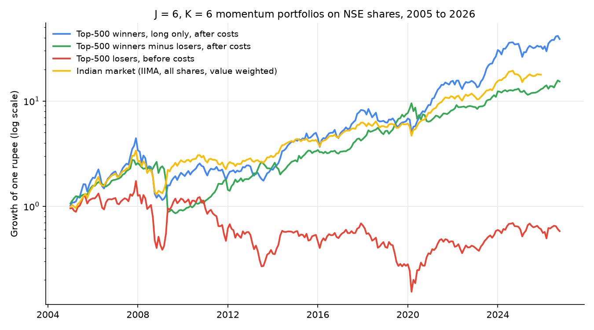
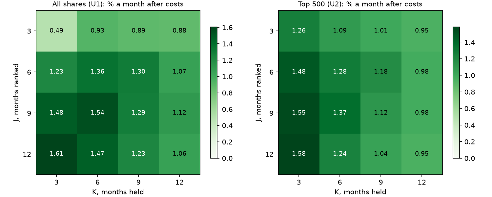

# Jegadeesh and Titman (1993) Momentum, Recreated for Indian Shares

This study recreates the relative-strength strategies of Jegadeesh and Titman (1993), "Returns to Buying Winners and Selling Losers", for shares listed on the National Stock Exchange of India from 2005 to 2026. Each month shares are ranked on their past J-month return, the top tenth (winners) is bought and the bottom tenth (losers) sold, and each month's choice is held for K months in overlapping portfolios, exactly as in the paper. It is run on all NSE shares and on the 500 most traded, as the paper's long-short portfolio and as long-only and futures-hedged portfolios that can actually be traded in India, before and after Indian trading costs.

**In one line:** buying 6-month winners and selling losers earned 1.28% a month after costs in India's 500 most traded shares (Newey-West t 3.07, 2005 to 2026), against 0.95% in the paper's US data, but the short side cannot be traded as the paper assumes, the effect shrinks to 0.85% a month in the top 200, and it lost 49% in a single month in May 2009.



**Interactive companion page:** [tradingmachine.co.in/papers/jegadeesh-titman-momentum-india](https://tradingmachine.co.in/papers/jegadeesh-titman-momentum-india/), where J, K, the universe, costs and the sample can be chosen and every table and chart is recomputed.

## Headline results

J = 6 months ranked, K = 6 months held, no skip, holding months January 2005 to October 2026 (262 months). Average monthly returns; Newey-West t in brackets.

| Portfolio | Before costs | After costs | Worst drawdown after costs |
|---|---|---|---|
| Paper, US 1965 to 1989, winners minus losers (p. 70) | 0.95% (plain t 3.07) | not reported | not reported |
| All NSE shares, winners minus losers | 1.64% (3.92) | 1.36% (3.26) | -62% |
| Top 500, winners minus losers | 1.42% (3.41) | 1.28% (3.07) | -69% |
| Top 200, winners minus losers | 0.99% (2.21) | 0.85% (1.90) | |
| Top 500 winners, long only | 1.82% (3.28) | 1.75% (3.16) | -74% |
| Top 500 winners hedged with NIFTY futures, 2012 to 2026 | 1.45% (3.64) | 1.05% (2.65) | -32% |
| F&O shares, losers shorted with stock futures | 0.77% (1.66) | 0.65% (1.40) | -67% |
| Indian market (IIMA, value weighted), same months | 1.34% | | -62% |



## What the Indian data says

1. **Momentum exists in India and is larger than in the paper.** All 64 winners-minus-losers strategies (two universes, with and without the skip week, four J, four K) are positive after costs; 6/6 earns 1.28% to 1.36% a month after costs.
2. **It lives mostly in mid and small shares.** Within the 200 most traded shares 6/6 earns 0.85% a month after costs and is not significant at 5%; among the 52 to 218 shares with stock futures it earns 0.65%.
3. **The short leg is the problem.** India allows only covered shorts. A 3% a year borrowing fee cuts the top-500 long-short to 1.03% a month. The tradeable versions are long-only winners and winners hedged with NIFTY futures.
4. **Long-only winners mostly carry market risk.** Their beta is 1.18; their alpha against the IIMA market is 0.25% a month (t 1.07), and against the NIFTY 500 since 2012 0.63% a month (t 2.06), with a deeper worst drawdown (-40% against -29%).
5. **Momentum crashes.** The top-500 long-short lost 49% in May 2009 when beaten-down losers rebounded; 2005 to 2009 earned almost nothing. From 2010 it earned 1.55% a month after costs (t 4.55) with a worst drawdown of -33%.
6. **No January effect; a March and April one instead.** The paper's 7% January loss does not exist in India. March, the last month of the Indian financial year, is strongly positive and April and December negative; July is the most reliable month.
7. **No long-run reversal in the top 500.** The paper finds half of the first year's gain lost by month 36; in India the cumulative return of 6-month winners minus losers keeps rising to 17.8% after 36 months in the top 500 and stays at about 14% among all shares.
8. **Results days carry part of it, as in the paper.** Around quarterly results announced in the first month after ranking, winners beat losers by 0.9% to 1.2% over three days (t 3.0 to 3.6); among all shares the gap turns negative 15 to 18 months later, as the paper found.
9. **It matches the outside benchmark.** Our 6/6 series correlates 0.75 to 0.83 with IIMA's Indian momentum factor (WML).

## The paper in brief

Jegadeesh and Titman ranked NYSE and AMEX stocks each month on their past 3, 6, 9 or 12 month returns, bought the top decile and sold the bottom decile, and held them for 3 to 12 months in overlapping portfolios (pp. 68-69). Over 1965 to 1989 every one of their 32 strategies made money; 6/6 earned 0.95% a month. The profits were not explained by risk, came mostly from the winners, disappeared every January, and partly reversed in the following two years. `paper/summary.md` covers every table with page numbers.

## What was changed for India, and why

| Item | Paper | India | Why |
|---|---|---|---|
| Shares | NYSE and AMEX | NSE company shares, all (U1) and top 500 by traded value with price of at least 10 rupees (U2); top 200 as a check | NSE is India's main exchange; U2 can be traded at size |
| Period | 1965 to 1989 | 2005 to 2026, plus a less reliable 1997 to 2004 | NSE daily files start in 1995; corporate action records are reliable from 2006 |
| Prices | CRSP daily returns | NSE daily price files adjusted with NSE's splits, bonuses and dividends; renamed shares joined | UBI's prices start in December 2019, miss delisted shares and some adjustments |
| Size | Market value | Median daily traded value | No Indian market-value history before 2024 |
| Costs | 0.5% one way, one test | Full Indian delivery costs and 0.1% to 0.3% market impact per side, every result | The house rules |
| Short selling | Free | Paper portfolio only; tradeable versions use NIFTY or stock futures | India allows only covered shorts |
| Market and risk-free rate | CRSP value-weighted index, 1-month T-bill | IIMA market factor and 91-day T-bill; NIFTY 500 from 2012 | Indian equivalents |
| Seasonality | January | All months, with the March year-end | India's financial year ends in March |

The full plan is in `plan/india_plan.md`.

## Data

| Source | Period | Coverage |
|---|---|---|
| NSE daily price files (bhavcopy) | 1996 to 2026 | 7,628 days, 5,723 symbols, delisted shares included |
| NSE corporate actions | 2000 to 2026 | 41,483 records; splits and bonuses complete only from 2006 |
| NSE symbol changes | 2003 to 2025 | 1,078 renames |
| NSE derivatives files | 2005 to 2026 | stock futures for 52 shares on the first day of 2005 and 218 in October 2026 |
| NSE index files | 2012 to 2026 | NIFTY 500, NIFTY 50, momentum indices |
| NSE results filings | 2007 to 2025 | quarterly results dates, for Table IX |
| IIMA Indian factor library | 1993 to 2025 | market, risk-free and WML factors |
| UBI through tradingmachine | 2019 to 2026 | used to cross-check adjustments |

What is missing: market value before 2024, total-return index history, BSE-only companies, and the risk-free rate for 2026 (December 2025's is repeated). `data/README.md` describes every file.

## Detailed results

`results/summary.md` sets each reproduced table beside the paper's, and `results/summary_tables.md` holds every table, built from the CSV files in `results/`.

## Caveats

- 192 strategy series were run in the core grid and about 150 more in checks; 6/6 was fixed as the lead result before any were seen. The best cells (12/3, 9/3) should be read with suspicion.
- The long-short results assume a short that India does not allow; they are a research benchmark.
- Losses of shares after their last trade are not charged in the base results; charging -30% or -100% leaves the long-short unchanged or higher and lowers long-only winners by up to 0.10% a month.
- Significance depends on the period: in the first half (2005 to 2015) the top-500 long-short is not significant at 5% (t 1.72 after costs).
- Returns before 2006 rest on inferred corporate actions and are less reliable.
- The backtest was reviewed adversarially; its report is `results/review/review.md`.

## Reproducing the results

```bash
python3.14 -m venv .venv
.venv/bin/pip install -e ".[test,database,charts]"
.venv/bin/pip install -e /path/to/data-and-analytics --no-deps
for source in bhavcopy fno index corporate_actions iima symbol_changes results_dates; do
  .venv/bin/python -m jegadeesh_titman_momentum_india.scripts.download_nse $source
done
for source in bhavcopy fno index corporate_actions iima ubi; do
  .venv/bin/python -m jegadeesh_titman_momentum_india.scripts.load_database $source
done
.venv/bin/python -m jegadeesh_titman_momentum_india.scripts.build_returns
.venv/bin/python -m jegadeesh_titman_momentum_india.scripts.run_grid
.venv/bin/python -m jegadeesh_titman_momentum_india.scripts.make_results
.venv/bin/python -m jegadeesh_titman_momentum_india.scripts.make_table_nine
.venv/bin/python -m jegadeesh_titman_momentum_india.scripts.make_summary_tables
.venv/bin/python -m jegadeesh_titman_momentum_india.scripts.make_charts
.venv/bin/pytest
```

The loading steps and `build_returns` need a TimescaleDB address in `RESEARCH_ANALYST_TIMESCALEDB_URL`; `run_grid` accepts `--skip-database` to keep its output in files only. The `ubi` load needs an export from UBI.

## Database

All data and results are stored in TimescaleDB under the schema `jegadeesh_and_titman_research_analyst`, so a monthly refresh only has to append new days. Every load is an upsert that is safe to run twice, and every table can be rebuilt from the raw files with the scripts in `src/jegadeesh_titman_momentum_india/scripts/`.

| Table | Holds | Source |
|---|---|---|
| `daily_prices_raw` | NSE daily prices for series EQ, BE and BZ, unadjusted | NSE bhavcopy files, 1996 to 2026 |
| `ubi_daily_prices` | UBI daily candles adjusted for splits and bonuses, used for cross-checks | UBI through `export_prices`, 2019 to 2026 |
| `corporate_actions` | Splits, bonuses, dividends and other actions | NSE corporate actions API, 2000 to 2026 |
| `index_daily` | Index closes, P/E, P/B and dividend yield | NSE `ind_close_all` files, 2012 to 2026 |
| `fno_stock_futures_daily` | Nearest-expiry stock futures prices | NSE derivatives bhavcopy, 2005 to 2026 |
| `iima_factors_monthly` | IIMA SMB, HML, WML, market premium and risk-free rate in percent | IIMA data library, 1993 to 2025 |
| `daily_returns` | Adjusted daily total returns | Built from the tables above |
| `return_flags` | Days whose return was inferred from a split ratio or zeroed | Built |
| `monthly_returns` | Calendar-month returns by share | Built |
| `universe_membership` | Shares in the all-shares (U1) and top-500 (U2) universes each month | Built |
| `strategy_returns_detail` | Monthly gross and net returns of every J, K, skip and universe | Built |

Monthly strategy returns also go to the shared table `results.strategy_returns` when the Results stage is done.

## Repository layout

```
paper/        the paper's citation, summary and related work (PDF git-ignored)
plan/         the plan for adapting the study to India
src/jegadeesh_titman_momentum_india/
  data/       downloaders and parsers, one class per source
  momentum/   returns, rankings, portfolios and statistics
  site/       the interactive companion page
  momentum/brief_page.py  builds the hand-off brief's web page
  scripts/    one command-line program per step
handoff/      the package for trading-agent: strategy skill, brief, monthly target script
tests/        unit tests on small made-up data, no network
results/      tables, charts and summary
data/         raw and intermediate data, git-ignored
```

To view the companion page locally, run `jt-momentum-app` after installing the package, or `python -m jegadeesh_titman_momentum_india.scripts.build_snapshot` to rebuild its data.

## Citation

See `CITATION.cff`. Please also cite the original paper:

Jegadeesh, N., and Titman, S. (1993). Returns to Buying Winners and Selling Losers: Implications for Stock Market Efficiency. *The Journal of Finance*, 48(1), 65-91. https://doi.org/10.1111/j.1540-6261.1993.tb04702.x

## Further tests from the paper

`results/further/` holds the Section III profit decomposition and lead-lag test, Tables IV and VI by size, joint F tests, event-time betas, buy-and-hold portfolios, the paper's flat 0.5% cost test, alphas against an equally weighted market and the January reversal. Headline: reversing the spread every January lowers the compound return (all shares 6/6: 18.5% to 14.6% a year) and loses in 16 of 22 Januaries, because Indian momentum has no January penalty. Details are in `results/summary.md`; reviewer notes are in `results/review/further_review.md`.
